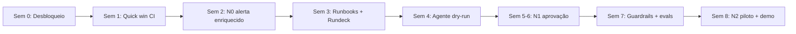

# Plano Turbo: IA em SRE em 8 semanas

> **Premissa:** aprender fazendo. Cada semana tem **um entregável demonstrável** e só o estudo necessário para construí-lo (*just-in-time*). O [roadmap completo](roadmap_ia_sre.md) continua valendo como visão de longo prazo.

---

## 1. Sim: Bedrock (AWS) dentro do GitHub Actions

Funciona igual ao GitHub Models: **o runner chama a API**, e o modelo roda na AWS. A autenticação é feita por **OIDC**, então não existe access key guardada no GitHub. O workflow assume uma role IAM temporária.

**Vantagens para o seu caso:**
- Os dados ficam **na conta AWS da empresa**: não são usados para treino, ficam na região escolhida e podem trafegar via PrivateLink. Isso costuma facilitar a aprovação do compliance.
- **Mesmo provedor no Actions e no agente.** O agente LangGraph no EKS usa `ChatBedrockConverse`, com a mesma conta, o mesmo billing e a mesma governança.
- Se no futuro vocês tiverem um **modelo próprio** (fine-tuning no Bedrock, *Custom Model Import* ou endpoint no SageMaker), o padrão de chamada é o mesmo.

### 1.1 Lado AWS (feito uma vez)

**Trust policy da role** (só o seu repositório e a branch `main` podem assumir):
```json
{
  "Effect": "Allow",
  "Principal": { "Federated": "arn:aws:iam::<ACCOUNT_ID>:oidc-provider/token.actions.githubusercontent.com" },
  "Action": "sts:AssumeRoleWithWebIdentity",
  "Condition": {
    "StringEquals": { "token.actions.githubusercontent.com:aud": "sts.amazonaws.com" },
    "StringLike":   { "token.actions.githubusercontent.com:sub": "repo:<ORG>/<REPO>:ref:refs/heads/main" }
  }
}
```

**Permissão mínima** (só invocar os modelos liberados):
```json
{
  "Effect": "Allow",
  "Action": ["bedrock:InvokeModel", "bedrock:InvokeModelWithResponseStream"],
  "Resource": [
    "arn:aws:bedrock:*::foundation-model/*",
    "arn:aws:bedrock:*:<ACCOUNT_ID>:inference-profile/*"
  ]
}
```
> Também é preciso habilitar o acesso ao modelo escolhido no console do Bedrock (*Model access*). Em produção, restrinja `Resource` ao ARN exato do modelo.

### 1.2 Workflow: analisar pipeline que falhou com Bedrock

```yaml
name: IA - Análise de falha (Bedrock)
on:
  workflow_run:
    workflows: ["Deploy"]
    types: [completed]

permissions:
  id-token: write      # OIDC com a AWS
  actions: read        # ler logs da execução
  contents: read
  issues: write

jobs:
  analisar:
    if: ${{ github.event.workflow_run.conclusion == 'failure' }}
    runs-on: ubuntu-latest
    steps:
      - uses: aws-actions/configure-aws-credentials@v4
        with:
          role-to-assume: ${{ vars.AWS_BEDROCK_ROLE_ARN }}
          aws-region: us-east-1

      - name: Coletar logs da falha
        env:
          GH_TOKEN: ${{ github.token }}
        run: |
          gh run view ${{ github.event.workflow_run.id }} -R ${{ github.repository }} --log-failed \
            | tail -n 300 > logs.txt

      - name: Perguntar ao Bedrock
        run: |
          jq -n --rawfile logs logs.txt '[{
            role: "user",
            content: [{ text: ("Você é um SRE sênior. Analise os logs abaixo e responda em português: 1) causa provável, 2) evidência (linhas), 3) próximo passo.\n\n" + $logs) }]
          }]' > msg.json

          aws bedrock-runtime converse \
            --model-id "${{ vars.BEDROCK_MODEL_ID }}" \
            --messages file://msg.json \
            --inference-config '{"maxTokens":800,"temperature":0.2}' \
            --query 'output.message.content[0].text' --output text > analise.md

      - name: Abrir issue com o diagnóstico
        env:
          GH_TOKEN: ${{ github.token }}
        run: |
          gh issue create -R ${{ github.repository }} \
            --title "🤖 Falha em ${{ github.event.workflow_run.name }} #${{ github.event.workflow_run.run_number }}" \
            --body-file analise.md
```
> `BEDROCK_MODEL_ID` fica numa *variable* do repositório. Assim, trocar de modelo (Claude, Llama, Nova, Mistral...) não exige mudar código.

O mesmo padrão vale para o **Azure OpenAI** (`azure/login` com OIDC), caso a escolha final seja Azure.

---

## 2. Atalhos que permitem entregar em 8 semanas

| Atalho | Por que funciona |
|---|---|
| **Começar com os 5 incidentes mais repetitivos** | Concentra a maior parte do toil e permite mostrar valor rápido |
| **Sem banco vetorial no início** | 5–10 runbooks cabem inteiros no prompt. RAG (ou Bedrock Knowledge Bases) só quando passar de ~30 runbooks |
| **Bedrock como provedor único** | Uma aprovação de compliance, um billing e uma única forma de autenticar (IAM) |
| **Usar o diagnóstico do Davis** | O webhook do Dynatrace já traz causa raiz e entidades. O agente só **roteia** |
| **Dry-run desde o dia 1** | O agente diz "eu executaria o job X com os parâmetros Y". Gera confiança antes de executar qualquer coisa |
| **Piloto em 1 time / 1 cluster não-prod** | Diminui o risco e a política interna para começar |
| **Dynatrace Workflows para casos determinísticos** | Se o alerta X sempre leva ao job Y, o Dynatrace chama o Rundeck direto, sem LLM. A IA fica para os casos ambíguos |

---

## 3. Cronograma de 8 semanas



> **Dedicação estimada:** 15–20 h/semana. O ideal é ter **2 pessoas**: uma focada em Rundeck/Actions/infra e outra no agente/LLM.

### Semana 0: Desbloqueio (2–3 dias)
- [ ] Aprovar o uso de Bedrock com o compliance (dados de log/alerta, região, mascaramento)
- [ ] Habilitar o *Model access* no Bedrock e criar o OIDC provider + role para o GitHub
- [ ] Levantar no Dynatrace o **top 5 de incidentes repetitivos** dos últimos 90 dias e o MTTR atual de cada um
- [ ] Definir o canal do piloto (Teams/Slack) e o time piloto

### Semana 1: Quick win #1, IA no CI ✨
**Entregável:** o workflow da seção 1.2 rodando em um repositório real.
**Estudo (≈4 h):**
- Docs do GitHub: *Configuring OpenID Connect in AWS*
- Docs da AWS: *Bedrock Converse API*
- DeepLearning.AI: *ChatGPT Prompt Engineering for Developers* (curso curto, ~1h30)

### Semana 2: Quick win #2, N0 alerta enriquecido
**Entregável:** problem do Dynatrace → serviço (FastAPI em container, ou Lambda) → Bedrock → mensagem no Teams/Slack com resumo, impacto, causa provável e runbook sugerido.
**Estudo (≈5 h):**
- Dynatrace: *Problem notifications / custom webhook* + API v2 (`/problems`, `/entities`)
- FastAPI: tutorial oficial (até "Request Body")
- DeepLearning.AI: *Functions, Tools and Agents with LangChain*

> 🎯 **Primeira demo para a liderança no fim da semana 2.**

### Semana 3: Runbooks como código + Rundeck pronto para a API
**Entregável:**
- Repositório `sre-runbooks` com os 5 runbooks no template (frontmatter com `job_id`, `risco`, `pre_condicoes`)
- 5 jobs do Rundeck idempotentes, com ACL e token de escopo mínimo
- Script Python que dispara um job e acompanha o status

**Estudo (≈4 h):**
- Rundeck Academy: módulos de *Jobs*, *ACL* e *Self-Service*
- Docs da API do Rundeck: `/job/{id}/run` e `/execution/{id}`

### Semana 4: Agente LangGraph em dry-run
**Entregável:** grafo `receber alerta → enriquecer (Dynatrace API) → escolher runbook (LLM + tool calling) → validar pré-condições → "eu executaria X"`, com a decisão postada no chat e logada.
**Estudo (≈6 h):**
- LangChain Academy: *Introduction to LangGraph*, módulos 1–3 (state, nodes, tools)
- LangChain: `ChatBedrockConverse`

### Semanas 5–6: N1 aprovação humana em produção (piloto)
**Entregável:**
- Card de aprovação no Teams/Slack → execução no Rundeck → verificação pós-ação (a métrica normalizou em 10 min?)
- Rollback de deploy via `workflow_dispatch` no GitHub Actions como segunda ferramenta do agente
- Deploy do agente no EKS (Helm, IRSA/Pod Identity para Bedrock, secrets no Secrets Manager)

**Estudo (≈6 h):**
- LangChain Academy: módulo de *Human-in-the-loop* e persistência
- DeepLearning.AI: *AI Agents in LangGraph*

### Semana 7: Guardrails, auditoria e evals
**Entregável:**
- Allowlist de jobs, validação de parâmetros (Pydantic), rate limit por serviço, kill switch
- **Bedrock Guardrails** (filtro de PII e prompt injection) aplicado às chamadas
- Evento de auditoria enviado ao Dynatrace a cada decisão
- Suite de evals com os incidentes históricos, rodando no GitHub Actions a cada PR no agente

**Estudo (≈4 h):**
- OWASP Top 10 for LLM Apps (*Prompt Injection* e *Excessive Agency*)
- DeepLearning.AI: *Evaluating AI Agents*

### Semana 8: N2 piloto + apresentação de resultados
**Entregável:**
- 1–2 runbooks de risco baixo (ex.: restart de deployment com ≥2 réplicas) em **modo autônomo** no piloto, com circuit breaker
- Apresentação para a liderança: MTTR antes × depois, nº de incidentes tratados, horas de toil economizadas, custo de LLM por incidente e próximos passos (expansão para mais times e para AKS/on-prem)

---

## 4. Riscos de acelerar e como mitigar

| Risco | Mitigação |
|---|---|
| Compliance trava o Bedrock | Iniciar a semana 0 **hoje**; usar GitHub Models só com dados não sensíveis enquanto isso |
| Agente executa ação errada | Dry-run → N1 → N2 apenas com histórico; allowlist + pré-condições validadas em código, não pelo LLM |
| Jobs do Rundeck não idempotentes | Revisão por pares obrigatória na semana 3; testar cada job 2x seguidas |
| Expectativa de "IA resolve tudo" | Comunicar o escopo claramente: 5 incidentes, 1 time, 8 semanas, com métricas |
| Dependência de uma só pessoa | Código no GitHub, PRs revisados, README de operação do agente |

---

## 5. O que mostrar à liderança, e quando

| Semana | Demo |
|---|---|
| 1 | Falha de pipeline vira issue com diagnóstico automático |
| 2 | Alerta do Dynatrace chega no chat já explicado, com o runbook certo |
| 6 | Mitigação com um clique, executada e verificada pela IA |
| 8 | Remediação autônoma no piloto + números de MTTR e toil |
