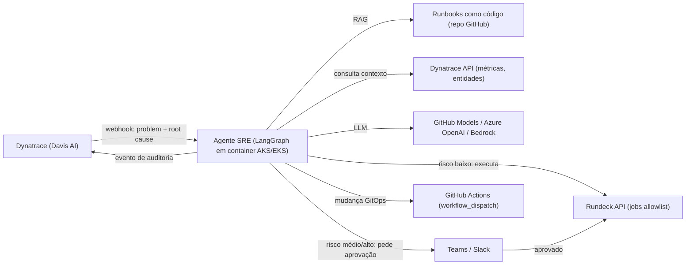
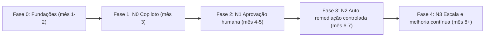

# Roadmap: IA Aplicada a SRE e DevOps

> **Visão:** sair de "humano lê alerta → procura runbook → executa job" para "Dynatrace detecta → agente decide → Rundeck executa com segurança → humano audita".

---

## 1. LLM: onde rodar o "cérebro"?

### 1.1 GitHub Models: como funciona

O GitHub tem um serviço chamado **GitHub Models**: um catálogo de modelos (família GPT/OpenAI, Llama, Mistral, DeepSeek, Phi etc.) hospedado pelo GitHub/Azure e acessível por uma **API compatível com OpenAI**.

**Detalhe importante:** o modelo **não roda dentro do runner**. O workflow apenas *chama* a API, autenticando com o próprio `GITHUB_TOKEN`. Não precisa de chave de API externa.

```yaml
# .github/workflows/resumir-falha.yml
name: Resumir falha de deploy
on:
  workflow_run:
    workflows: ["Deploy"]
    types: [completed]

permissions:
  contents: read
  models: read          # <- obrigatório para usar GitHub Models

jobs:
  analisar:
    if: ${{ github.event.workflow_run.conclusion == 'failure' }}
    runs-on: ubuntu-latest
    steps:
      - name: Analisar com IA
        id: ia
        uses: actions/ai-inference@v1
        with:
          model: openai/gpt-4.1-mini
          system-prompt: "Você é um SRE. Explique a causa provável da falha e sugira o próximo passo."
          prompt: "Logs: ${{ github.event.workflow_run.html_url }}"
      - run: echo "${{ steps.ia.outputs.response }}"
```

Formas de uso:

| Forma | Uso típico |
|---|---|
| `actions/ai-inference` | Passo de IA dentro de qualquer workflow |
| API REST (`https://models.github.ai/inference`) | Chamada via `curl`, Python (SDK OpenAI) ou LangChain (`ChatOpenAI` com `base_url`) |
| `gh models run` (extensão CLI) | Testes rápidos no terminal |
| Arquivos `.prompt.yml` no repo | Prompts versionados e avaliados como código |

**Limites:**
- O tier gratuito tem **cota diária por modelo e por usuário**; ao estourar, a API retorna `429`. Serve para prototipar.
- Para produção, a organização precisa habilitar **uso pago** ou conectar a própria chave (*bring your own key*, ex.: Azure OpenAI).
- Chamar a IA a partir do Actions é **lento para tempo real**: só a fila e o boot do runner levam dezenas de segundos.

**Onde o GitHub Models brilha no seu contexto:**
- Analisar logs de workflows que falharam.
- Revisar PRs de IaC e de runbooks.
- Gerar rascunhos de postmortem.
- Prototipar o agente sem precisar de aprovação de cloud.

**Onde não usar:** como cérebro do loop de auto-remediação em tempo real. Esse papel fica com um serviço sempre ligado (container no AKS/EKS).

### 1.2 E rodar um modelo *de verdade* dentro do Actions?

| Opção | Viável? | Observação |
|---|---|---|
| Ollama em runner hospedado (`ubuntu-latest`) | Sim, só para testes | Só CPU, modelos pequenos (1–3B); baixa o modelo a cada execução e é lento |
| Runner com GPU (larger runners pagos) | Sim | Caro para o que oferece neste caso |
| Runner self-hosted no AKS/EKS (ARC) + Ollama/vLLM | Sim | Faz sentido se o compliance exigir que **nada saia da rede** |

### 1.3 Matriz de decisão de LLM

| Critério | GitHub Models | Azure OpenAI (AI Foundry) | AWS Bedrock | Local (Ollama/vLLM) |
|---|---|---|---|---|
| Esforço para começar | ⭐ Mínimo | Médio | Médio | Alto |
| Produção / SLA | Limitado | ✅ | ✅ | Depende de vocês |
| Dados na rede corporativa | Não | Private Endpoint | PrivateLink | ✅ Total |
| Qualidade em raciocínio/tool-calling | Alta | Alta | Alta (Claude, Llama, Nova) | Média (modelos menores) |
| Custo | Grátis para prototipar | Por token | Por token | GPU / infra |

**Recomendação:**
1. **Prototipar com GitHub Models**, porque destrava hoje sem burocracia.
2. Escrever o agente com **LangChain/LangGraph usando uma interface de modelo abstrata**. Trocar de provedor vira uma linha de configuração.
3. **Produção:** Azure OpenAI ou Bedrock, escolhendo **onde o agente vai rodar** e **qual cloud já tem contrato/DPA aprovado**.

**Perguntas para levar ao time de Segurança/Compliance:**
- [ ] Logs e alertas de produção podem sair para um provedor de LLM? Quais (Microsoft, AWS, GitHub)?
- [ ] Existe contrato corporativo com Azure OpenAI ou Bedrock?
- [ ] Há exigência de mascarar dados sensíveis (PII, IPs, secrets) antes de enviar ao modelo?
- [ ] O GitHub Models está habilitado na organização (Enterprise/Org settings)?

---

## 2. Arquitetura alvo



**Princípios:**
- **O agente escolhe, não inventa.** Ele só pode chamar jobs de uma *allowlist*, com parâmetros validados por schema. Nunca executa um comando gerado livremente.
- **O Rundeck é a camada de segurança.** Concentra ACLs, auditoria, jobs idempotentes e timeouts.
- **O Davis faz o diagnóstico; o agente faz o roteamento.** Não reinvente o RCA que o Dynatrace já entrega.
- **Tudo é auditável.** Cada decisão (alerta → contexto → raciocínio → ação → resultado) é registrada e enviada de volta ao Dynatrace como evento.

---

## 3. Fases do roadmap



### Fase 0: Fundações (meses 1–2)
**Objetivo:** ter peças confiáveis para a IA orquestrar depois.

| Frente | Entregáveis |
|---|---|
| GitHub Actions | Reusable workflows (`workflow_call`), composite actions, OIDC para AWS/Azure (sem secrets estáticos), environments com aprovação, `workflow_dispatch` com inputs tipados |
| Rundeck | 5–10 jobs de mitigação **idempotentes** (restart de deployment, scale de réplicas, limpeza de disco, flush de cache, failover); ACLs por projeto; token de API dedicado com escopo mínimo |
| Runbooks | Repositório `sre-runbooks` com template padrão (ver abaixo), revisado via PR |
| Dynatrace | Alerting profiles e problem notifications por webhook; tags de ownership e ambiente nas entidades |
| Baseline | Medir hoje: MTTA, MTTR, nº de incidentes/mês, % resolvido com ação repetitiva |

**Template de runbook (frontmatter legível por máquina):**
```markdown
---
id: rb-k8s-high-latency-restart
sintomas: ["alta latência", "response time degradation"]
entidades_dynatrace: ["SERVICE", "PROCESS_GROUP"]
acao:
  tipo: rundeck
  job_id: "a1b2c3..."
  parametros: { namespace: "string", deployment: "string" }
risco: baixo            # baixo | medio | alto
pre_condicoes: ["réplicas >= 2", "sem deploy nos últimos 15 min"]
limite_execucoes: "1 por hora por serviço"
rollback: "n/a (restart é seguro)"
---
## Diagnóstico
...
## Mitigação
...
```

**Critério de saída:** jobs do Rundeck chamáveis via API com sucesso; ≥10 runbooks no padrão; baseline de métricas registrado.

### Fase 1: N0 Copiloto, só leitura (mês 3)
**Objetivo:** gerar valor sem nenhum risco operacional.

- Serviço FastAPI que recebe o webhook do Dynatrace.
- O agente busca contexto (Dynatrace API + RAG nos runbooks) e posta no Teams/Slack: **resumo, causa provável, runbook sugerido e link**.
- Quick wins via GitHub Models no Actions: análise de falha de pipeline e revisão de PR de IaC.

**Critério de saída:** o runbook sugerido é o correto em **≥80%** dos casos ao longo de 4 semanas (validar com feedback 👍/👎 no próprio chat).

### Fase 2: N1 Aprovação humana (meses 4–5)
**Objetivo:** o agente propõe uma ação concreta e o humano aprova com um clique.

- LangGraph com nó *human-in-the-loop* (interrupt) e card de aprovação no Teams/Slack.
- Execução via Rundeck API, acompanhamento do status do job e verificação pós-ação (a métrica voltou ao normal?).
- Rollbacks GitOps via `workflow_dispatch` no GitHub Actions.
- Mascaramento de dados sensíveis antes de enviar ao LLM.

**Critério de saída:** taxa de aprovação sem edição ≥90%; zero ações erradas aprovadas; tempo do alerta até a ação < 5 min.

### Fase 3: N2 Auto-remediação controlada (meses 6–7)
**Objetivo:** autonomia **só** para ações de risco baixo com histórico comprovado.

- Política: um runbook só fica `autonomo: true` depois de N aprovações seguidas sem erro na Fase 2.
- Guardrails: rate limit por serviço, *circuit breaker* (2 falhas → volta para N1), janela de mudança e kill switch global.
- Evento "Remediação automática executada" enviado ao Dynatrace, que fica visível na timeline do problem.

**Critério de saída:** ≥30% dos incidentes elegíveis resolvidos sem humano; nenhum incidente causado pelo agente.

### Fase 4: N3 Escala e melhoria contínua (mês 8+)
- Avaliações automatizadas (evals) com incidentes históricos a cada mudança de prompt ou modelo, rodando no próprio GitHub Actions.
- Rascunho automático de postmortem e sugestão de novos runbooks a partir de incidentes resolvidos manualmente.
- Multi-agente (ex.: um agente de diagnóstico e outro de execução), se fizer sentido.
- Expansão para on-premise e outros domínios (banco de dados, rede).

### KPIs do programa

| KPI | Onde medir |
|---|---|
| MTTR (antes × depois) | Dynatrace problems |
| % de incidentes com runbook sugerido corretamente | Feedback no chat |
| % de auto-remediação | Logs do agente |
| Ações revertidas ou incorretas | Rundeck + auditoria |
| Horas de toil economizadas | Execuções × tempo manual médio |
| Custo de LLM por incidente | Billing do provedor |

---

## 4. Trilha de estudos (≈5–6 h/semana)

A trilha anda **um passo à frente** do roadmap: você estuda o que vai aplicar na fase seguinte.

### Bloco 1: GitHub Actions avançado (semanas 1–4) → Fase 0
| Semana | Estudo | Prática |
|---|---|---|
| 1 | Microsoft Learn: *Automate workflows with GitHub Actions*; sintaxe, contexts, expressions | Workflow com matrix + cache |
| 2 | KodeKloud GH-200: reusable workflows, composite actions | Criar um repositório de workflows reutilizáveis |
| 3 | OIDC com AWS e Azure; environments e proteções | Deploy em AKS/EKS sem secrets estáticos |
| 4 | `workflow_dispatch`/`repository_dispatch` + **GitHub Models** (`actions/ai-inference`) | Workflow que resume falhas de pipeline com IA ✨ |

### Bloco 2: Rundeck (semanas 5–7) → Fase 0
| Semana | Estudo | Prática |
|---|---|---|
| 5 | Rundeck Academy: jobs, nodes, options | Job de restart de deployment k8s |
| 6 | ACLs, Key Storage, Self-Service Operations | Projeto isolado com token de API de escopo mínimo |
| 7 | API do Rundeck (executar job, consultar status) | Script Python que dispara um job e espera o resultado |

### Bloco 3: Dynatrace como fonte de gatilhos (semana 8) → Fase 0/1
| Semana | Estudo | Prática |
|---|---|---|
| 8 | Dynatrace University: Davis AI, problem notifications, API v2 (problems, entities, events) | Webhook custom apontando para um endpoint de teste (ex.: webhook.site) |

### Bloco 4: Fundamentos de LLM e agentes (semanas 9–12) → Fase 1
| Semana | Estudo | Prática |
|---|---|---|
| 9 | DeepLearning.AI: *ChatGPT Prompt Engineering for Developers* + *Functions, Tools and Agents with LangChain* | Chamar o GitHub Models via Python (SDK OpenAI) |
| 10 | RAG: DeepLearning.AI *LangChain: Chat with Your Data* | RAG sobre o repositório de runbooks |
| 11 | FastAPI básico + Docker | Endpoint `/webhook/dynatrace` em container |
| 12 | Integração | **Entregar o N0:** alerta → resumo + runbook sugerido no Teams/Slack |

### Bloco 5: LangGraph e agentes autônomos (semanas 13–18) → Fases 2–3
| Semana | Estudo | Prática |
|---|---|---|
| 13–14 | LangChain Academy: *Introduction to LangGraph* (state, nodes, edges, tool calling) | Grafo: classificar → buscar contexto → escolher runbook |
| 15 | LangGraph: *human-in-the-loop*, persistência e checkpoints | Aprovação via card no Teams/Slack |
| 16 | DeepLearning.AI: *AI Agents in LangGraph* + *Agentic AI* (Andrew Ng) | Verificação pós-ação (reflection) |
| 17 | Observabilidade de LLM: LangSmith ou OpenTelemetry | Tracing de cada decisão do agente |
| 18 | Evals: DeepLearning.AI *Evaluating AI Agents* | Suite de evals com incidentes históricos rodando no Actions |

### Bloco 6: Produção e segurança (semanas 19–22) → Fase 3
| Semana | Estudo | Prática |
|---|---|---|
| 19 | OWASP Top 10 for LLM Applications (prompt injection, excessive agency) | Revisar guardrails do agente |
| 20 | Azure OpenAI ou Bedrock (o que o compliance aprovar) | Trocar o provedor de LLM via configuração |
| 21 | Deploy no AKS/EKS: Helm, secrets (Key Vault / Secrets Manager), workload identity | Agente rodando no cluster |
| 22 | Revisão | Documento de arquitetura + apresentação de resultados do N1 |

### Certificações opcionais
- **GH-200: GitHub Actions** (fecha o Bloco 1)
- **AI-102 (Azure AI Engineer)** ou **AWS Certified AI Practitioner**, conforme a cloud escolhida para o LLM

---

## 5. Próximos passos imediatos
1. [ ] Levar as perguntas de compliance da seção 1.3 ao time responsável.
2. [ ] Verificar se o GitHub Models está habilitado na organização (Settings → Copilot/Models).
3. [ ] Medir o baseline (MTTR, incidentes repetitivos) no Dynatrace.
4. [ ] Listar os 10 incidentes mais repetitivos dos últimos 3 meses; eles viram os primeiros runbooks.
5. [ ] Começar a semana 1 da trilha.
