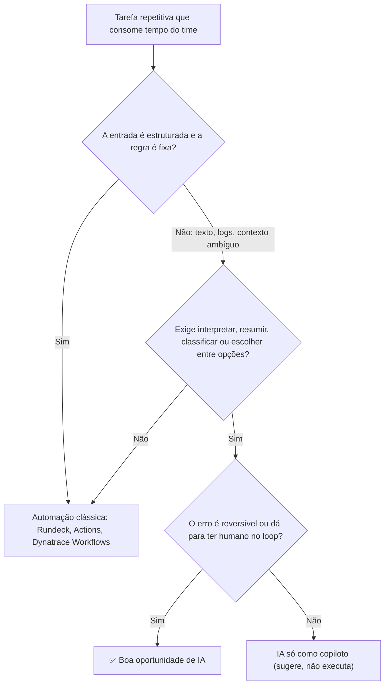

# Trilha de Estudos: Enxergar e Entregar Oportunidades de IA em SRE

> **Objetivo:** em 8 semanas, ser a pessoa que olha para a operação e diz *"aqui cabe IA, aqui não cabe, e é assim que a gente faz"*, com protótipos para provar.
>
> **Dedicação:** ~10–12 h/semana (≈4 h de curso, 2 h de leitura, 4–6 h de lab).

Cada semana tem 4 blocos:

| Bloco | Para quê |
|---|---|
| 📚 Curso | Base técnica |
| 📖 Leitura | Modelo mental e repertório |
| 🛠️ Lab | Mão na massa (vira portfólio) |
| 🔍 Caça a oportunidades | Treinar o "olhar" na **sua** operação |

---

## Parte 1: Como enxergar oportunidades (o framework)

### 1.1 O filtro "isso é caso para IA?"



> 💡 **Regra de ouro:** a IA é boa para **transformar o caos em decisão** (logs, alertas, textos, contexto). A automação clássica é boa para **executar a decisão**. A maioria dos casos vencedores combina as duas.

### 1.2 Os 5 verbos da IA em operações
Quando ouvir uma reclamação do time, pergunte se a IA pode fazer uma destas coisas:
1. **Resumir:** incidente, thread de 200 mensagens, log de 5 mil linhas.
2. **Classificar e rotear:** alerta para o time certo, ticket para a fila certa, severidade.
3. **Extrair:** transformar texto livre em dados (postmortems → causas raiz em planilha).
4. **Recomendar:** qual runbook usar, qual mudança causou o problema.
5. **Gerar:** rascunho de postmortem, PR de correção, query do Dynatrace (DQL), script.

### 1.3 Matriz de priorização
Para cada ideia, dê nota de 1 a 5:

| Critério | Pergunta |
|---|---|
| **Dor** | Quantas horas/mês isso consome? Quanto afeta o MTTR? |
| **Frequência** | Acontece todo dia ou uma vez por trimestre? |
| **Dados disponíveis** | O contexto está acessível via API (Dynatrace, GitHub, Rundeck)? |
| **Risco** (inverso) | Se a IA errar, qual o estrago? |
| **Visibilidade** | A liderança vai perceber o ganho? |

**Faça primeiro** o que tiver nota alta em Dor, Frequência e Dados, e risco baixo.

### 1.4 Canvas de oportunidade (1 página)
Use este modelo para documentar e "vender" cada ideia:
```
Problema:            (quem sofre, quanto tempo perde)
Gatilho:             (o que inicia o fluxo: alerta, PR, ticket, horário)
Entrada:             (dados que a IA recebe)
O que a IA faz:      (um dos 5 verbos)
Saída / Ação:        (mensagem, issue, job Rundeck, PR)
Humano no loop?:     (sim/não, onde)
Métrica de sucesso:  (MTTR, horas economizadas, % de acerto)
Esforço estimado:    (dias)
Riscos:              (dados sensíveis, ação errada)
```

### 1.5 Catálogo inicial de oportunidades em SRE

| Área | Oportunidade | Verbo | Risco |
|---|---|---|---|
| Incidentes | Alerta do Dynatrace explicado em linguagem simples, com o runbook sugerido | Resumir/Recomendar | Baixo |
| Incidentes | Resumo automático do war room para quem entra no meio | Resumir | Baixo |
| Incidentes | Auto-remediação via Rundeck | Recomendar + executar | Médio/Alto |
| Pós-incidente | Rascunho de postmortem com timeline (Dynatrace + chat + deploys) | Gerar | Baixo |
| Pós-incidente | Mineração de postmortems antigos → causas recorrentes | Extrair | Baixo |
| CI/CD | Diagnóstico de pipeline que falhou | Resumir | Baixo |
| CI/CD | Review de PR de Terraform/Helm (segurança, custo, boas práticas) | Recomendar | Baixo |
| Mudanças | "Qual deploy causou isso?": correlacionar deploys do GitHub com o problem do Dynatrace | Recomendar | Baixo |
| Conhecimento | Chatbot que responde perguntas sobre runbooks e arquitetura | Resumir | Baixo |
| Conhecimento | Gerar runbooks a partir de incidentes resolvidos manualmente | Gerar | Baixo |
| Observabilidade | Pergunta em português → query DQL do Dynatrace | Gerar | Baixo |
| FinOps | Explicar anomalias de custo AWS/Azure | Resumir | Baixo |
| Plataforma | Self-service via chat ("escala meu serviço em homolog") → Rundeck | Classificar + executar | Médio |

---

## Parte 2: Plano de 8 semanas

### Semana 1: Fundamentos de IA e o "olhar" de oportunidade
- 📚 **AI For Everyone** (DeepLearning.AI/Coursera, Andrew Ng, ~6 h). Não é técnico, mas é **o** curso para aprender a identificar onde a IA cabe num negócio.
- 📚 **Generative AI for Everyone** (DeepLearning.AI, ~3 h). Mostra o que LLMs fazem bem e mal.
- 📖 Google SRE Book, capítulo **"Eliminating Toil"** (grátis em sre.google): a definição de toil é sua bússola.
- 🛠️ Testar LLMs com dados reais (sanitizados): cole um log de erro, um alerta do Dynatrace e um postmortem num chat de IA e peça resumo, classificação e próximo passo. Anote onde ele acerta e onde erra.
- 🔍 **Inventário de toil:** liste 15 tarefas repetitivas do time (pergunte aos colegas!), aplique o filtro da seção 1.1 e as notas da 1.3. **Escolha o top 3.**

### Semana 2: Prompting e LLM via API
- 📚 **ChatGPT Prompt Engineering for Developers** (DeepLearning.AI, curto, ~1h30)
- 📚 **AWS Skill Builder: Amazon Bedrock Getting Started** (gratuito) + documentação da *Converse API*
- 📖 Anthropic: **"Building Effective Agents"** (artigo). É a melhor referência sobre quando usar workflow e quando usar agente.
- 🛠️ Script Python que envia um alerta do Dynatrace (JSON) ao Bedrock (ou GitHub Models) e devolve uma **saída estruturada** (JSON com `severidade`, `causa_provavel`, `runbook`).
- 🔍 Escreva o **canvas** (seção 1.4) da oportunidade nº 1 do seu top 3.

### Semana 3: GitHub Actions + IA no CI
- 📚 **GitHub Skills** (skills.github.com, grátis e interativo): *Hello GitHub Actions*, *Reusable workflows*
- 📚 KodeKloud **GH-200**: módulos de reusable workflows, OIDC e environments
- 📖 Docs do GitHub: *About security hardening with OpenID Connect*
- 🛠️ **Quick win:** workflow que diagnostica falhas de pipeline com Bedrock via OIDC (está no [plano turbo](plano_turbo_8_semanas.md)).
- 🔍 Mapeie onde os pipelines da empresa mais falham e quanto tempo se perde investigando. Esse número vira argumento.

### Semana 4: Dynatrace + Rundeck como "mãos" da IA
- 📚 **Dynatrace University:** Davis AI, Problems, Workflows/AutomationEngine, API v2
- 📚 **Rundeck Academy / PagerDuty University:** Jobs, ACL, Self-Service Operations, API
- 📖 Docs do **Dynatrace MCP Server** e do **Davis CoPilot**: entender o que o próprio Dynatrace já oferece de IA, para não reinventar.
- 🛠️ Webhook do Dynatrace → FastAPI local → Bedrock → mensagem no Teams/Slack (o **N0**).
- 🔍 Classifique os 10 incidentes mais repetitivos em: **(a)** só automação clássica, **(b)** IA copiloto, **(c)** candidato a auto-remediação.

### Semana 5: Agentes e tool calling
- 📚 **Functions, Tools and Agents with LangChain** (DeepLearning.AI, curto)
- 📚 **LangChain Academy: Introduction to LangGraph** (grátis), módulos 1–3
- 📖 OpenAI: **"A Practical Guide to Building Agents"** (PDF)
- 🛠️ Agente LangGraph em **dry-run**: alerta → enriquece com a Dynatrace API → escolhe runbook → "eu executaria o job X".
- 🔍 Para cada runbook existente, pergunte: *se um agente fosse executar isso, o que precisaria estar escrito?* Os gaps encontrados viram oportunidade de padronização.

### Semana 6: Human-in-the-loop, RAG e MCP
- 📚 LangChain Academy: módulo de **Human-in-the-loop** e persistência
- 📚 **AI Agents in LangGraph** (DeepLearning.AI)
- 📚 **MCP: Build Rich-Context AI Apps with Anthropic** (DeepLearning.AI). O MCP é o padrão que conecta agentes a ferramentas (GitHub, Dynatrace e outras já têm servidores MCP).
- 📚 **LangChain: Chat with Your Data** (RAG, DeepLearning.AI)
- 🛠️ Aprovação com um clique no chat → job no Rundeck → verificação pós-ação (o **N1**).
- 🔍 Identifique **2 oportunidades fora de incidentes** (ex.: review de PR de Terraform, chatbot de runbooks) e faça o canvas delas.

### Semana 7: IA em produção: avaliação, segurança e custo
- 📚 **Evaluating AI Agents** (DeepLearning.AI)
- 📚 **Agentic AI** (DeepLearning.AI, Andrew Ng): padrões de reflection, planning e multi-agente
- 📖 **OWASP Top 10 for LLM Applications** (foco em *Prompt Injection* e *Excessive Agency*)
- 📖 AWS: documentação do **Bedrock Guardrails**
- 🛠️ Suite de evals com incidentes históricos rodando no GitHub Actions + cálculo de **custo por incidente** (tokens × preço).
- 🔍 Para cada oportunidade do seu backlog, anote o **risco** e o **guardrail** necessário. É isso que dá segurança para a liderança aprovar.

### Semana 8: Consolidar e vender
- 📚 **Generative AI with Large Language Models** (DeepLearning.AI + AWS, Coursera). Aprofunda como LLMs funcionam; termine no ritmo que der.
- 📖 Chip Huyen, **"AI Engineering"** (O'Reilly): leia os capítulos de avaliação e de arquitetura de aplicações.
- 🛠️ Organize os labs num repositório (README, diagrama, demo gravada).
- 🔍 **Entregável final:** backlog priorizado com **5–10 oportunidades**, cada uma com canvas, nota da matriz e estimativa. Apresente à liderança junto com as demos.

---

## Parte 3: Depois das 8 semanas

### Certificações (escolha 1–2)
| Certificação | Por que |
|---|---|
| **AWS Certified AI Practitioner (AIF-C01)** | Rápida; valida a base de IA/GenAI na AWS. Boa para crachá interno |
| **GH-200: GitHub Actions** | Consolida a fundação de CI/CD |
| **AWS Certified Machine Learning Engineer – Associate** ou **AI-102 (Azure)** | Se quiser aprofundar na cloud escolhida |

### Para continuar enxergando oportunidades
- **Newsletters:** *The Batch* (DeepLearning.AI), *SRE Weekly*, *Latent Space*
- **Cursos curtos:** acompanhe os lançamentos em deeplearning.ai/short-courses (saem toda semana, 1–2 h cada)
- **Hugging Face Agents Course** (grátis): visão agnóstica de framework
- **Hábito semanal (30 min):** revise os incidentes e tickets da semana com a pergunta *"qual dos 5 verbos resolveria isso?"* e alimente o backlog.

### Sinais de que você está pronto
- [ ] Consegue explicar em 2 minutos por que um caso é (ou não é) para IA
- [ ] Tem um backlog priorizado com números (horas, MTTR, custo)
- [ ] Tem 3+ protótipos funcionando com dados reais
- [ ] Sabe dizer qual guardrail cada caso precisa
- [ ] A liderança te procura antes de decidir algo sobre IA em operações 😉
